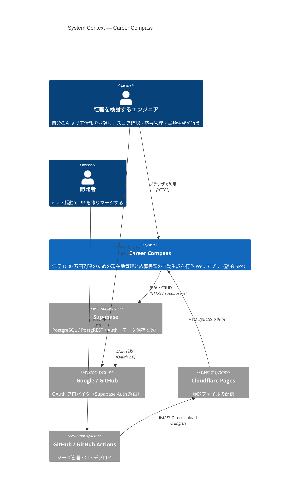
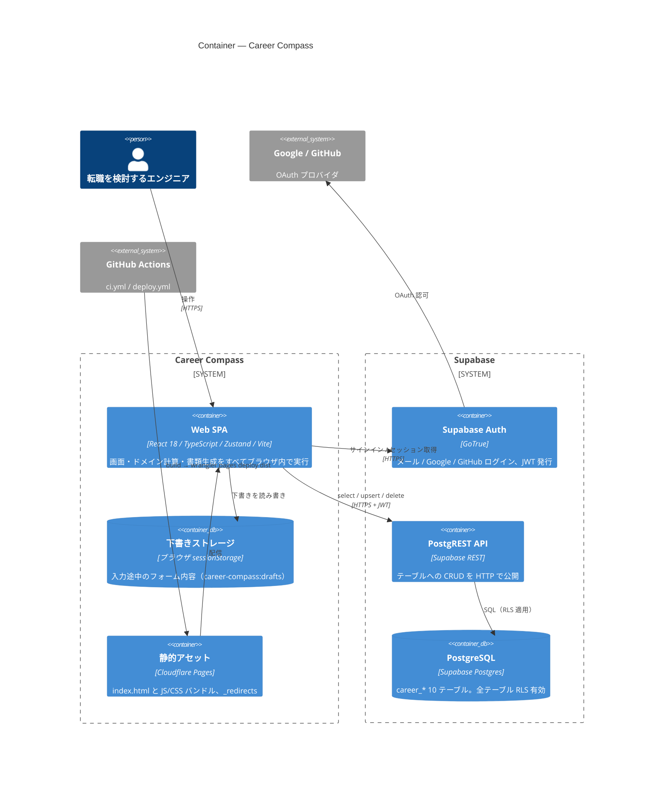
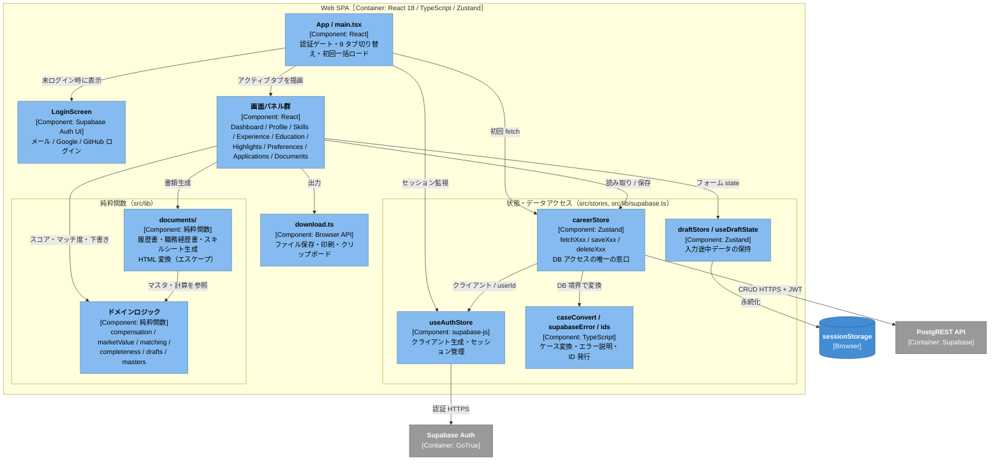
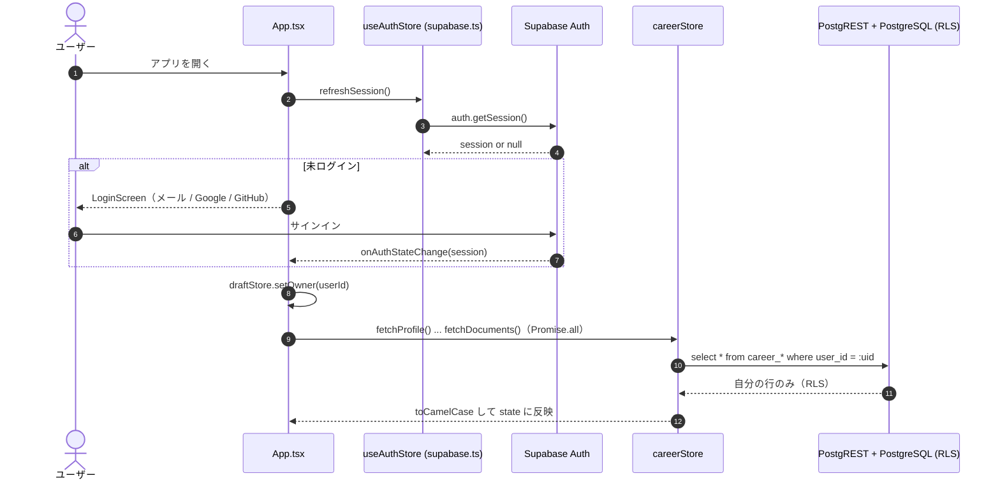
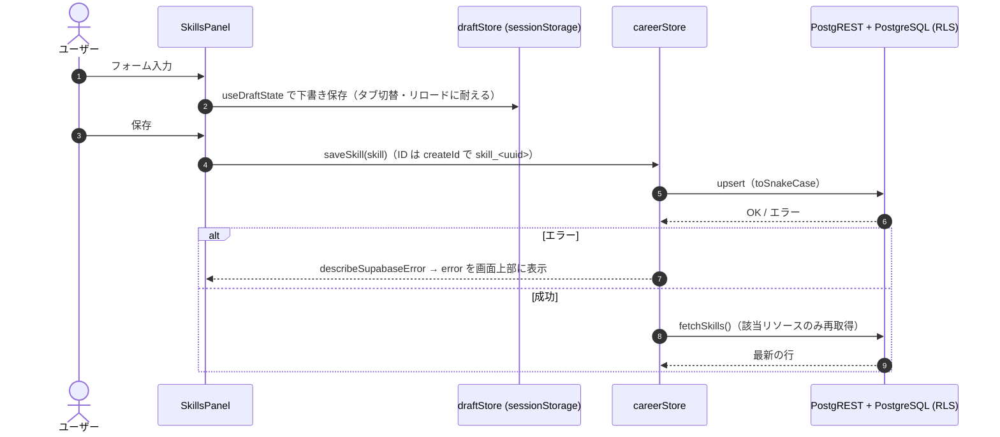
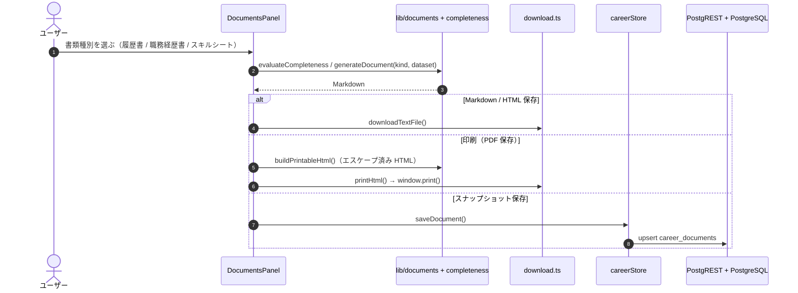

# アーキテクチャ（C4 モデル）

Career Compass の構成を [C4 モデル](https://c4model.com/) の 3 階層
（System Context / Container / Component）で整理する。
記述はリポジトリ内のコード・設定に基づく。リポジトリから確認できない点は **未確認** と明記する。

- 詳細な仕様: [specification.md](specification.md)
- デプロイ手順: [deployment.md](deployment.md)

## 概要

### 目的

エンジニア転職で **年収 1000 万円** に到達するための、現在地（スキル・職歴・年収）・
希望条件・応募状況の管理と、応募書類（履歴書 / 職務経歴書 / スキルシート）の自動生成を行う Web アプリ。
年収ギャップ、1000 万円レンジ到達力スコア（6 軸）、応募先と希望条件のマッチ度を算出する。

### 主な利用者

- **転職を検討しているエンジニア本人**（1 ユーザー = 自分のデータのみ。RLS で `auth.uid() = user_id` の行だけを参照・更新）
- **開発者**（GitHub で issue → PR → マージし、GitHub Actions 経由で Cloudflare Pages へ配信）

### 構成の要点

- **バックエンドサーバーを持たない静的 SPA**。ブラウザから Supabase（PostgREST + Auth）を直接呼ぶ
  （`src/stores/careerStore.ts` 冒頭コメント「API サーバーは無い」）
- データ保護は Supabase 側の **RLS** で担保（`supabase/migrations/20260812000000_career_tables.sql`）
- スコアリング・書類生成は `src/lib/` の純粋関数で、すべてブラウザ内で完結する
- 配信は **Cloudflare Pages**（Direct Upload）。Pages Functions / KV / D1 は使っていない

### 技術スタック

| 区分 | 技術 | 根拠 |
|------|------|------|
| 言語 | TypeScript 5.6 | `package.json`, `tsconfig.json` |
| UI | React 18（`react-dom/client` の `createRoot`、StrictMode） | `src/main.tsx` |
| ビルド / 開発サーバー | Vite 5（`@vitejs/plugin-react`、dev は port 3100、出力 `dist/`） | `vite.config.ts` |
| 状態管理 | Zustand 5 | `src/stores/`, `src/lib/supabase.ts` |
| BaaS | Supabase（PostgreSQL + PostgREST + Auth + RLS）、`@supabase/supabase-js` 2 | `src/lib/supabase.ts`, `supabase/migrations/` |
| 認証 UI | `@supabase/auth-ui-react` / `auth-ui-shared`（メール + Google + GitHub） | `src/components/LoginScreen.tsx` |
| テスト | Jest 29 + ts-jest + jsdom | `jest.config.cjs`, `src/**/__tests__/` |
| CI / CD | GitHub Actions（Node 20）、`cloudflare/wrangler-action@v4`（wrangler 4） | `.github/workflows/` |
| ホスティング | Cloudflare Pages（SPA フォールバックは `public/_redirects`） | `docs/deployment.md` |
| ランタイム要件 | Node.js >= 18（ローカル開発） | `package.json` の `engines` |

Docker / IaC（Terraform 等）/ Supabase CLI の設定ファイル（`supabase/config.toml`）はリポジトリに存在しない。
Supabase・Cloudflare のプロジェクトはダッシュボードで手動作成する前提（`docs/deployment.md`）。

---

## Level 1: System Context 図



| 名前 | 種別 | 技術 | 責務 |
|------|------|------|------|
| 転職を検討するエンジニア | Person | Web ブラウザ | プロフィール・スキル・職歴・希望条件・応募を登録し、ダッシュボードと生成書類を使う |
| 開発者 | Person | Git / GitHub | issue 起票、ブランチ作成、PR、マージ（`CONTRIBUTING.md`） |
| Career Compass | Software System（本システム） | React SPA | 入力管理、スコアリング、マッチ度判定、書類生成。サーバーサイド処理は持たない |
| Supabase | External System | PostgreSQL / PostgREST / GoTrue | `career_*` 10 テーブルの永続化、RLS による行アクセス制御、認証セッション発行 |
| Google / GitHub（OAuth） | External System | OAuth 2.0 | ソーシャルログイン。有効化は Supabase 側の Authentication 設定で行う |
| Cloudflare Pages | External System | 静的ホスティング | ビルド済み `dist/` の配信。`/* → /index.html` で SPA フォールバック |
| GitHub / GitHub Actions | External System | GitHub Actions | CI（typecheck / test / build）と main マージ時のデプロイ |

補足:

- `src/App.tsx` 冒頭に「認証は資産シミュレーターと同じ Supabase セッションを共有する」とある。
  同一 Supabase プロジェクトを別アプリ（資産シミュレーター）と共用している可能性があるが、
  そのアプリはこのリポジトリに含まれず、実際の共用関係は **未確認**。
- メール認証のメール送信元（Supabase 標準 SMTP か独自 SMTP か）は **未確認**。

---

## Level 2: Container 図



| 名前 | 種別 | 技術 | 責務 |
|------|------|------|------|
| Web SPA | Container | React 18 / TypeScript / Zustand、Vite でバンドル | 全画面（9 タブ）、認証ゲート、ドメイン計算、書類の Markdown / HTML 生成、ダウンロード・印刷・クリップボード |
| 下書きストレージ | Container（ブラウザ内ストア） | `sessionStorage`（キー `career-compass:drafts`） | タブ切り替え・リロードをまたいで入力途中の内容を保持。ユーザー ID に紐づき、切り替えで破棄 |
| 静的アセット | Container | Cloudflare Pages | ビルド成果物の配信。サーバー処理なし |
| Supabase Auth | Container（外部 SaaS） | GoTrue | ログインとセッション（JWT）。`supabase.auth.getSession` / `onAuthStateChange` で SPA が監視 |
| PostgREST API | Container（外部 SaaS） | Supabase REST | `supabase.from(table)` からのクエリを受ける。anon key + ユーザー JWT で呼ばれる |
| PostgreSQL | Container（DB） | Supabase Postgres | `career_profiles` / `skills` / `experiences` / `projects` / `educations` / `certifications` / `highlights` / `preferences` / `applications` / `documents`。`user_id` は `auth.users` を参照し ON DELETE CASCADE |
| GitHub Actions | External | `ci.yml` / `deploy.yml` | PR・main push で typecheck / test / build。main push（配信物に影響するパス）で Cloudflare Pages へデプロイ |

存在しないもの（コードで確認）:

- 独自 API サーバー、バッチ / ジョブ、メッセージキュー、オブジェクトストレージ（Supabase Storage は未使用）
- Supabase Edge Functions、DB 関数 / トリガー、Cloudflare Pages Functions / KV / D1
- PDF 生成サーバー（PDF は `window.print()` によるブラウザの「PDF に保存」）

---

## Level 3: Component 図（Web SPA）

中心となるコンテナは Web SPA のみ（Supabase はマネージドサービス）なので、その内部を示す。



| 名前 | 種別 | 技術 | 責務 |
|------|------|------|------|
| App / main.tsx | Component | React | `src/main.tsx` でマウント。`src/App.tsx` で認証状態を監視し、未ログインなら LoginScreen、ログイン後は 10 リソースの `fetchXxx` を `Promise.all` で 1 回だけ呼ぶ。アクティブタブだけを描画 |
| LoginScreen | Component | `@supabase/auth-ui-react` | `src/components/LoginScreen.tsx`。providers は `google` / `github`（メールは Auth UI の既定） |
| 画面パネル群 | Component | React | `src/components/*Panel.tsx`, `Dashboard.tsx`, `ui.tsx`（共通 UI） |
| draftStore / useDraftState | Component | Zustand + sessionStorage | `src/stores/draftStore.ts`。`useState` の代わりにフォーム state を保持し、持ち主（ユーザー ID）切り替えで破棄 |
| careerStore | Component | Zustand | `src/stores/careerStore.ts`。テーブル名の対応表を持ち、ミューテーション後は該当リソースの `fetchXxx` だけを呼ぶ。`useCareerDataset` で計算用データセットを組み立てる |
| supabase.ts（useAuthStore） | Component | supabase-js | `VITE_SUPABASE_URL` / `VITE_SUPABASE_ANON_KEY` 未設定なら起動時に例外（値はログに出さない） |
| caseConvert / supabaseError / ids | Component | TypeScript | `src/lib/caseConvert.ts`, `supabaseError.ts`, `ids.ts` |
| ドメインロジック | Component | 純粋関数 | `compensation.ts`（年収ギャップ・必要転職回数・パイプライン）、`marketValue.ts`（6 軸スコア）、`matching.ts`（マッチ度）、`completeness.ts`（書類充足度）、`drafts.ts`（自己PR・志望動機・年収交渉の下書き）、`masters/`（福利厚生・みなし残業）、`format.ts` |
| documents/ | Component | 純粋関数 | `src/lib/documents/`。`generateDocument(kind, dataset)` がエントリ。`html.ts` で入力をエスケープして印刷用 HTML を作る |
| download.ts | Component | Browser API | Blob ダウンロード、`window.open` + `print()`、`navigator.clipboard` |

---

## 主要なデータフロー

### 1. ログインと初回ロード



### 2. 入力の保存（例: スキルの登録）



### 3. 書類生成と出力



---

## ディレクトリ構成

```
.
├── .github/
│   ├── workflows/ci.yml        # PR / main push: typecheck → test → build
│   ├── workflows/deploy.yml    # main push: Secrets 確認 → build → Cloudflare Pages へ配信
│   ├── ISSUE_TEMPLATE/         # バグ報告 / 機能要望テンプレート
│   └── pull_request_template.md
├── docs/
│   ├── architecture.md         # 本書（C4 モデル）
│   ├── specification.md        # 詳細仕様（画面・計算ロジック・テーブル）
│   └── deployment.md           # Cloudflare Pages / GitHub / Supabase の設定手順
├── public/_redirects           # SPA フォールバック（Cloudflare Pages）
├── src/
│   ├── main.tsx                # エントリポイント（React のマウント）
│   ├── App.tsx                 # 認証ゲート・タブ切り替え・初回ロード
│   ├── App.css                 # スタイル
│   ├── components/             # 画面パネル・ログイン画面・共通 UI
│   ├── stores/                 # Zustand ストア（careerStore = DB 窓口、draftStore = 下書き）
│   ├── lib/                    # 純粋関数のドメインロジック + Supabase クライアント + 副作用の集約
│   │   ├── documents/          # 書類生成（Markdown / HTML）
│   │   ├── masters/            # 福利厚生・みなし残業のマスタ
│   │   └── __tests__/          # ドメインロジックの単体テスト
│   ├── types/career.ts         # 型定義のみ
│   └── vite-env.d.ts           # VITE_ 環境変数の型
├── supabase/migrations/        # テーブル定義・RLS ポリシー（追記のみ）
├── index.html                  # Vite のエントリ HTML
├── vite.config.ts              # dev port 3100 / 出力 dist
├── jest.config.cjs             # Jest 設定
├── tsconfig.json
├── .env.example                # VITE_SUPABASE_URL / VITE_SUPABASE_ANON_KEY
├── CLAUDE.md / CONTRIBUTING.md # 開発規約
└── README.md
```

| ディレクトリ | 役割 |
|--------------|------|
| `src/components/` | 画面。DB へは直接触れず、ストア経由でデータを扱う |
| `src/stores/` | 状態とデータアクセス。DB アクセスはここに集約 |
| `src/lib/` | 純粋関数（DB・React・`new Date()` に依存しない）。例外は `supabase.ts`（クライアント生成）と `download.ts`（ブラウザ副作用） |
| `src/types/` | ドメインの型。ロジックは置かない |
| `supabase/migrations/` | スキーマと RLS。既存ファイルは書き換えず新規追加する |
| `.github/workflows/` | CI とデプロイ |
| `docs/` | 仕様・デプロイ手順・アーキテクチャ |

## 未確認事項

- 本番の Supabase プロジェクト・Cloudflare Pages プロジェクトの実際の名前・リージョン・プラン
- Supabase Auth で実際に有効化されているプロバイダ（コード上は email / Google / GitHub を表示）
- 「資産シミュレーター」との Supabase プロジェクト共用の有無と範囲
- 独自ドメインの有無（`docs/deployment.md` は `*.pages.dev` を前提に記載）
